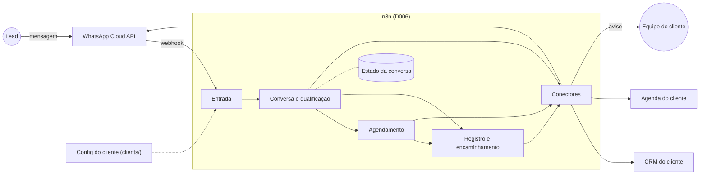

# Visão geral da arquitetura

Como as automações da Zenvolyx se encaixam: n8n, conectores, configuração por cliente e dados.
O motivo de cada escolha está no [DECISIONS.md](../../DECISIONS.md) (D006 em diante); aqui fica só o desenho.
Detalhes do WhatsApp: [whatsapp.md](whatsapp.md).

## Componentes

| Parte | Onde fica | Papel |
|-------|-----------|-------|
| Fluxos principais | `automations/<nome>/` | As etapas do lead (abaixo), em JSON exportado do n8n. |
| Conectores | `integrations/<tipo>/<fornecedor>/` | Sub-workflows do n8n que falam com WhatsApp, CRM ou agenda. O contrato de entrada e saída de cada tipo fica em `integrations/<tipo>/README.md`; os fluxos chamam o contrato, nunca o fornecedor direto (D011). |
| Config do cliente | `clients/<id>/config.json` | Tudo que muda por cliente: perguntas, regras de qualificação, mensagens e conectores usados, sem secrets (D014; formato no [clients/README.md](../../clients/README.md)). |
| Credenciais | cofre do n8n | De preferência, uma credencial da agência por fornecedor, com acesso concedido pelo cliente (D014). Nunca no repositório. |
| Serviços | `services/` | Código TypeScript só quando o n8n não resolver bem (D011). Nenhum previsto por enquanto. |
| Ferramentas | `scripts/` e `tests/` | Verificações com Vitest (workflows exportados, configs). Rodam no computador, não em produção. |

## Caminho de um lead

1. **Entrada.** O webhook responde 200 na hora e só depois processa. Confere a assinatura e o
   formato do payload, descarta eventos repetidos pelo ID da mensagem, identifica o cliente pelo
   número que recebeu a mensagem e carrega a config dele. Eventos de status (entregue, lido) param
   aqui; falha de envio gera alerta. Outras fontes de lead (formulário, anúncio) entram por fluxos
   de entrada próprios, que geram o mesmo evento interno.
2. **Conversa e qualificação.** Lê o estado da conversa, decide o próximo passo pelas regras da
   config e responde pelo conector de WhatsApp. Se houver IA (T011), ela interpreta a mensagem e
   redige a resposta; quem decide se o lead está qualificado são as regras da config. O estado é
   salvo a cada passo.
3. **Agendamento.** O lead qualificado escolhe entre horários vindos do conector de agenda. A IA
   nunca inventa horário, preço ou disponibilidade. Contrato em [integrations/calendar](../../integrations/calendar/README.md).
4. **Registro e encaminhamento.** Cria ou atualiza o lead no CRM do cliente ([contrato](../../integrations/crm/README.md)) e avisa a
   equipe quando o caso pede atendimento humano. Quando um humano assume, a automação para de
   responder àquele lead.

Mensagem enviada fora da janela de 24h desde a última mensagem do lead (lembrete, retorno) exige
template aprovado e custa mais (D007). Por isso, priorizar fluxos em que o lead inicia a conversa.

## Dados e LGPD

Regras em D013 e na seção 5 do [AGENTS.md](../../AGENTS.md). Na prática:

- O registro do lead é o CRM do cliente. O n8n guarda só o estado da conversa e os IDs de
  mensagens já processadas, em tabelas internas do n8n, e apaga o estado após um período sem
  interação.
- Execução com sucesso não guarda dados; execução com erro guarda por poucos dias, para diagnóstico.
- Alertas e logs trazem cliente, fluxo e erro, nunca telefone, nome ou texto de mensagem.
- Com IA, o provedor recebe só o texto necessário para a etapa (critérios na T011).

## Erros

- Chamadas externas tentam de novo automaticamente antes de falhar.
- Um fluxo de erro global avisa a Zenvolyx, sem dados pessoais.
- Se a conversa falhar no meio, o lead recebe uma mensagem segura e o caso vai para atendimento humano.

## Ambientes

| | Local (agora) | Produção (primeiro cliente) |
|-|---------------|-----------------------------|
| Onde | Computador do dono, com Docker | Oracle Cloud Always Free ou VPS (D006) |
| Webhooks | Túnel (ex.: Cloudflare Tunnel), ligado só durante testes | HTTPS público só para os caminhos de webhook |
| WhatsApp | Número de teste da Meta (D007) | Número de cada cliente (T007) |
| Banco do n8n | SQLite, o padrão | Decidir na migração |

Nos dois ambientes:

- a versão do n8n é fixa, nunca `latest`; atualizar de propósito, testando antes no local;
- a chave de criptografia do n8n (`N8N_ENCRYPTION_KEY`) fica no `.env` e tem cópia de segurança:
  sem ela, as credenciais salvas no n8n se perdem;
- o editor do n8n sempre exige login e, em produção, não fica exposto: clientes não acessam o n8n (D006).

A montagem do ambiente local é a T012.

## Ciclo de um workflow

1. Editar no n8n local.
2. Exportar o JSON para a pasta da automação ou do conector.
3. Conferir: sem credenciais, tokens ou dados de execução (`pinData`) no JSON (verificação
   automática na T013), fixture fictícia em `tests/fixtures/` e roteiro de verificação no README da pasta.
4. Commit e merge (seção 10 do AGENTS.md).
5. Importar na produção. As credenciais são criadas à mão em cada instância.

## Em aberto

| Tarefa | Assunto |
|--------|---------|
| T011 | IA: papel na conversa, provedor, custo e limites de dados; inclui áudio e o Meta Business Agent |
| T017 | WhatsApp: entrada de clientes reais (Tech Provider, cadastro incorporado, coexistência) |

O que já está definido e falta construir (ambiente local, verificações, conectores e fluxos) está
no [TASKS.md](../../TASKS.md).
